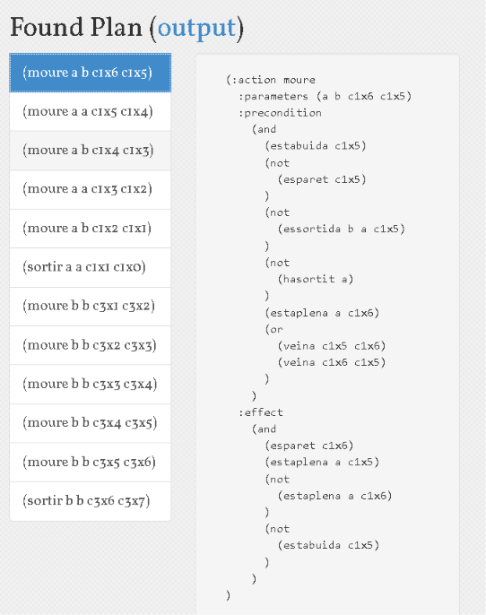
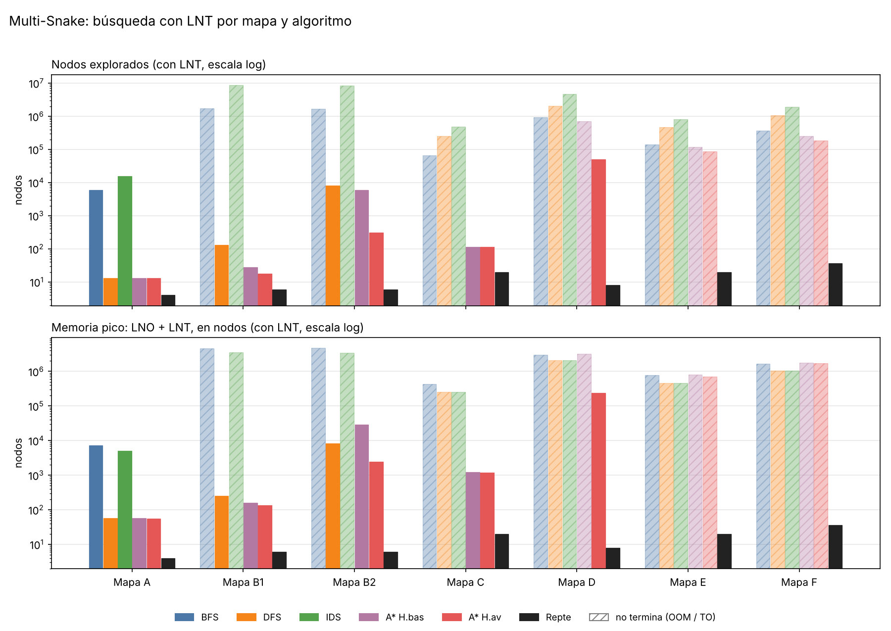

# Multi-Snake: PDDL, búsqueda ciega e informada

**Equipo:** ManhattanSearch · **Integrantes:** Fabio Julio Valdes Velazco, Carles Sejas · **Repositorio:** [\[enlace GitHub\]](https://github.com/StainsS/Activitat1-PROP)
**Máquina de pruebas:** CPU:11th Gen Intel(R) Core(TM) i7-1165G7 @2.8 Ghz - RAM: 16GB, SO:Ubuntu 24.04-5 LTS · JVM con `-Xmx2g` · límite de 120 s por búsqueda.

Notación: **LNO** = lista de nodos abiertos, **LNT** = lista de nodos cerrados, **OOM** = sin memoria, **TO** = supera los 120 s, **H.bas / H.av** = heurística básica / avanzada. La memoria se mide como pico de nodos (LNO + LNT).

---

## Plan (planificador LAMA-first en editor.planning.domains)

Plan devuelto por LAMA-first, de **12 acciones** (el óptimo para el mapa A):
```
(moure a b c1x6 c1x5)
(moure a a c1x5 c1x4)
(moure a b c1x4 c1x3)
(moure a a c1x3 c1x2)
(moure a b c1x2 c1x1)
(sortir a a c1x1 c1x0)
(moure b b c3x1 c3x2)
(moure b b c3x2 c3x3)
(moure b b c3x3 c3x4)
(moure b b c3x4 c3x5)
(moure b b c3x5 c3x6)
(sortir b b c3x6 c3x7)
```



---

# Segunda parte: implementación (resumen)

- **`Mapa`**: `equals`/`hashCode` comparan la cuadrícula completa (paredes y rastro) y la posición de todos los agentes. `distancesFrom` es un BFS que no atraviesa paredes ni agentes y no expande desde las casillas de salida (una salida se puede alcanzar pero no atravesar).
- **BFS, DFS (límite de profundidad 50), IDS**: con `usarLNT` (un `Set<Mapa>`) o control de repetidos en la rama actual. IDS reutiliza `dfsLimitat` de DFS. Todas cortan a los 120 s.
- **A\***: LNO como cola de prioridad ordenada por f = g + h (desempate por menor h y luego FIFO). Descarta los estados cuya heurística es infinita.
- **`HeuristicaBasica`**: suma de distancias Manhattan de los agentes que no han salido.
- **`HeuristicaAvancada`**: suma de las distancias BFS reales de cada agente a su salida. Si alguna es inalcanzable devuelve infinito y el estado se descarta.
- **`CercaRepte`**: algoritmo para E y F, descrito en [10].

---

# Tercera parte: estudio

## [1] Cuadro resumen

Óptimos: A = 12, B1 = 17, B2 = 19, C = 112, D = 42 (E y F: se desconoce).

| Mapa | Algoritmo | LNT | Resultado | Long. | Explorados | Tallados | Mem. pico | Tiempo (ms) |
|---|---|---|---|---|---|---|---|---|
| A | BFS | no | ✓ | 12 | 697.815 | 0 | 471.259 | 874 |
| A | BFS | sí | ✓ | 12 | 5.893 | 6.080 | 7.197 | 30 |
| A | DFS | no | ✓ | 12 | 13 | 0 | 23 | 1 |
| A | DFS | sí | ✓ | 12 | 13 | 0 | 58 | 1 |
| A | IDS | no | ✓ | 12 | 993.967 | 0 | 31 | 469 |
| A | IDS | sí | ✓ | 12 | 15.770 | 13.547 | 5.053 | 54 |
| A | A* H.bas | no | ✓ | 12 | 13 | 0 | 23 | 1 |
| A | A* H.bas | sí | ✓ | 12 | 13 | 0 | 58 | 6 |
| A | A* H.av | no | ✓ | 12 | 13 | 0 | 20 | 1 |
| A | A* H.av | sí | ✓ | 12 | 13 | 0 | 55 | 1 |
| A | Repte | sí | ✓ | 12 | 4 | 0 | 4 | 2 |
| B1 | BFS | no | OOM | – | 877.813 | 0 | 2.632.065 | 9.638 |
| B1 | BFS | sí | OOM | – | 1.723.101 | 3.122.131 | 4.685.412 | 52.252 |
| B1 | DFS | no | ✓ (no óptima) | 19 | 129 | 0 | 67 | 2 |
| B1 | DFS | sí | ✓ (no óptima) | 19 | 129 | 0 | 252 | 1 |
| B1 | IDS | no | TO | – | 152.988.717 | 0 | 66 | 120.002 |
| B1 | IDS | sí | OOM | – | 8.732.965 | 8.390.047 | 3.500.908 | 107.433 |
| B1 | A* H.bas | no | ✓ | 17 | 28 | 0 | 66 | 1 |
| B1 | A* H.bas | sí | ✓ | 17 | 28 | 0 | 159 | 1 |
| B1 | A* H.av | no | ✓ | 17 | 18 | 0 | 56 | 1 |
| B1 | A* H.av | sí | ✓ | 17 | 18 | 0 | 133 | 2 |
| B1 | Repte | sí | ✓ | 17 | 6 | 0 | 6 | 2 |
| B2 | BFS | no | OOM | – | 839.417 | 0 | 2.670.936 | 17.189 |
| B2 | BFS | sí | OOM | – | 1.664.232 | 3.049.440 | 4.730.166 | 54.142 |
| B2 | DFS | no | ✓ (no óptima) | 31 | 24.930.927 | 0 | 95 | 23.765 |
| B2 | DFS | sí | ✓ (no óptima) | 31 | 8.050 | 7.115 | 8.203 | 18 |
| B2 | IDS | no | TO | – | 171.866.216 | 0 | 58 | 120.001 |
| B2 | IDS | sí | OOM | – | 8.428.433 | 7.854.424 | 3.490.878 | 83.112 |
| B2 | A* H.bas | no | ✓ | 19 | 469.868 | 0 | 780.309 | 2.363 |
| B2 | A* H.bas | sí | ✓ | 19 | 6.007 | 4.723 | 29.046 | 65 |
| B2 | A* H.av | no | ✓ | 19 | 1.444 | 0 | 5.302 | 89 |
| B2 | A* H.av | sí | ✓ | 19 | 306 | 257 | 2.419 | 50 |
| B2 | Repte | sí | ✓ | 19 | 6 | 0 | 6 | 2 |
| C | BFS | no | OOM | – | 27.424 | 0 | 224.878 | 3.277 |
| C | BFS | sí | OOM | – | 67.003 | 357.491 | 434.552 | 11.095 |
| C | DFS | no | TO | – | 11.476.463 | 0 | 500 | 120.001 |
| C | DFS | sí | OOM | – | 252.142 | 355.581 | 253.100 | 8.592 |
| C | IDS | no | TO | – | 40.690.833 | 0 | 82 | 120.001 |
| C | IDS | sí | OOM | – | 485.998 | 686.183 | 252.557 | 13.459 |
| C | A* H.bas | no | ✓ | 112 | 113 | 0 | 547 | 11 |
| C | A* H.bas | sí | ✓ | 112 | 113 | 0 | 1.206 | 8 |
| C | A* H.av | no | ✓ | 112 | 113 | 0 | 541 | 150 |
| C | A* H.av | sí | ✓ | 112 | 113 | 0 | 1.200 | 221 |
| C | Repte | sí | ✓ | 112 | 20 | 12 | 20 | 22 |
| D | BFS | no | OOM | – | 483.838 | 0 | 1.603.799 | 11.051 |
| D | BFS | sí | OOM | – | 938.487 | 1.816.216 | 3.021.486 | 29.490 |
| D | DFS | no | TO | – | 47.020.174 | 0 | 171 | 120.001 |
| D | DFS | sí | OOM | – | 2.082.634 | 1.875.418 | 2.082.923 | 55.660 |
| D | IDS | no | TO | – | 127.279.992 | 0 | 55 | 120.001 |
| D | IDS | sí | OOM | – | 4.643.476 | 4.113.966 | 2.091.788 | 46.593 |
| D | A* H.bas | no | OOM | – | 737.795 | 0 | 1.315.544 | 12.886 |
| D | A* H.bas | sí | OOM | – | 702.533 | 648.210 | 3.179.510 | 29.395 |
| D | A* H.av | no | OOM | – | 756.390 | 0 | 1.275.249 | 74.343 |
| D | A* H.av | sí | ✓ | 42 | 50.011 | 51.774 | 240.513 | 2.614 |
| D | Repte | sí | ✓ | 42 | 8 | 0 | 8 | 9 |
| E | BFS | no | OOM | – | 57.820 | 0 | 407.033 | 3.740 |
| E | BFS | sí | OOM | – | 140.856 | 661.659 | 779.217 | 12.512 |
| E | DFS | no | TO | – | 19.311.397 | 0 | 406 | 120.002 |
| E | DFS | sí | OOM | – | 465.402 | 667.500 | 466.101 | 12.888 |
| E | IDS | no | TO | – | 70.279.454 | 0 | 80 | 120.001 |
| E | IDS | sí | OOM | – | 808.633 | 1.124.637 | 466.099 | 13.140 |
| E | A* H.bas | no | OOM | – | 148.775 | 0 | 314.235 | 4.826 |
| E | A* H.bas | sí | OOM | – | 116.721 | 113.518 | 797.720 | 7.336 |
| E | A* H.av | no | TO | – | 137.472 | 0 | 322.327 | 120.061 |
| E | A* H.av | sí | OOM | – | 86.942 | 75.899 | 714.433 | 94.177 |
| E | Repte | sí | ✓ | 133 | 20 | 2 | 20 | 64 |
| F | BFS | no | OOM | – | 143.087 | 0 | 905.855 | 6.237 |
| F | BFS | sí | OOM | – | 370.880 | 1.646.827 | 1.672.635 | 22.706 |
| F | DFS | no | TO | – | 32.575.522 | 0 | 427 | 120.001 |
| F | DFS | sí | OOM | – | 1.052.474 | 1.403.411 | 1.053.237 | 20.675 |
| F | IDS | no | TO | – | 92.976.141 | 0 | 92 | 120.001 |
| F | IDS | sí | OOM | – | 1.930.686 | 3.070.019 | 1.049.891 | 27.839 |
| F | A* H.bas | no | OOM | – | 291.378 | 0 | 747.641 | 8.732 |
| F | A* H.bas | sí | OOM | – | 250.401 | 246.739 | 1.765.582 | 15.063 |
| F | A* H.av | no | TO | – | 206.514 | 0 | 816.956 | 120.001 |
| F | A* H.av | sí | TO | – | 185.150 | 335.992 | 1.707.154 | 120.486 |
| F | Repte | sí | ✓ | 97 | 36 | 8 | 36 | 24 |

En `Repte`, **Explorados** son estados (con uno o más agentes ya fuera) y **Memoria** es el tamaño de su LNT, porque no hay LNO (ver [10]).

**Cumplimiento de la checklist:** A lo resuelven todos los algoritmos. En B1 empiezan a fallar BFS e IDS. En B2 entre los algorimos no informados solo DFS resuelve, con una solución no óptima. C solo lo resuelve A\*. D solo A\* con H.av y LNT. E y F no los resuelve ningún algoritmo estándar, pero sí el reto.



## [2] ¿Tiene sentido buscar ciclos subiendo por la rama actual (`usarLNT=false`)?

**No.** Cada movimiento convierte la casilla abandonada en pared de forma permanente, así que el conjunto de paredes crece estrictamente en cada paso y un estado no puede repetirse nunca en su propia rama. **Los ciclos son imposibles.**

La comprobación está en el contador de tallados: en las 35 ejecuciones con `usarLNT=false` (7 mapas × 5 algoritmos) vale exactamente **0**. Con LNT sí hay tallados (p. ej. 6.080 en BFS/mapa A), pero no son ciclos, son **transposiciones**: el mismo estado alcanzado moviendo los agentes en distinto orden.

Buscar ciclos en la rama no poda nada y cuesta O(profundidad) comparaciones de cuadrícula completa por hijo. Solo ahorra memoria respecto a la LNT, a costa de repetir una cantidad enorme de trabajo (697.815 nodos frente a 5.893 en BFS/mapa A).

## [3] Factor de ramificación medio (real) del mapa A con BFS

Se calcula el factor efectivo b\* resolviendo N = Σ b^i (i = 0..d), con d = 12 y N = nodos explorados:

| | N | b\* |
|---|---|---|
| BFS sin LNT | 697.815 | **≈ 2,97** |
| BFS con LNT | 5.893 | **≈ 1,94** |

El máximo teórico es 8 (2 agentes × 4 direcciones). Es mucho menor porque las casillas ya recorridas son pared.

**Ventajas de la LNT** (BFS, mapa A): 118× menos nodos explorados (697.815 → 5.893), 65× menos memoria incluso contando la LNT (471.259 → 7.197) y 29× menos tiempo (874 → 30 ms). El 51 % de los sucesores generados con LNT (6.080 de 11.973) eran estados ya vistos. La solución sigue siendo óptima.

## [4] Diferencias entre B1 y B2

En ambos mapas la suma de distancias Manhattan es **exactamente el coste óptimo** (17 y 19), así que con H.bas el valor f inicial ya es el definitivo y A\* solo expande nodos con f = f\*. La diferencia está en cuántos estados hay con ese f:

- **B1:** las rutas óptimas de A y B son compatibles (no se bloquean entre sí), así que un descenso directo llega a la meta: A\* explora 28 nodos (18 con H.av).
- **B2:** las rutas óptimas se cruzan y el rastro de un agente bloquea al otro. Manhattan no lo ve, así que A\* expande una meseta enorme de estados con f = 19 que son callejones sin salida: 6.007 nodos con LNT y 469.868 sin LNT con H.bas.
- **H.av** detecta esos bloqueos, porque el BFS tiene en cuenta los rastros: 306 y 1.444 nodos.
- **DFS** (sin garantía de óptimo): 129 nodos en B1 y 8.050 con LNT (24,9 millones sin LNT) en B2, con soluciones de 19 y 31 movimientos frente a 17 y 19.
- **BFS e IDS:** fallan en ambos mapas (OOM o TO).

## [5] Admisibilidad y consistencia

**H.bas (Manhattan).** Es admisible: cada agente necesita al menos tantos movimientos como su distancia Manhattan, y cada movimiento mueve a un solo agente una casilla, así que la suma es una cota inferior del coste restante. Es consistente: un movimiento cambia la distancia Manhattan de un agente en ±1 (y en el movimiento de salida pasa de 1 a 0), así que h(n) ≤ 1 + h(n').

**H.av (BFS por agente).** Es admisible: las paredes son permanentes y una casilla ocupada por otro agente pasará a ser pared cuando este se vaya, así que ningún agente podrá usar nunca lo que el BFS considera bloqueado. Su distancia BFS es por tanto una cota inferior de sus movimientos reales, y la suma lo es del coste total. Es consistente: un movimiento solo añade obstáculos (la casilla abandonada pasa a pared), así que las distancias de los demás agentes no disminuyen, y el agente que se mueve se acerca como mucho 1. Si algún agente no puede llegar a su salida devuelve ∞ y el estado se descarta (no tiene solución).

**Consecuencia para A\* con LNT.** Con h consistente, f no decrece a lo largo de un camino y la primera vez que se expande un estado ya se ha llegado a él por un camino óptimo. La LNT puede descartar los repetidos sin reabrir nodos y se conserva la optimalidad. Además, en este problema g es función del estado (cada movimiento añade una pared y el movimiento de salida añade dos pero a la vez elimina un agente), así que dos caminos al mismo estado siempre cuestan lo mismo. Por eso basta con un `Set` como LNT. Empíricamente, A\*(H.av) con LNT da 42 en D, el óptimo del enunciado.

## [6] ¿Qué heurística da mejores resultados?

**H.av**, porque ve los obstáculos que H.bas ignora (paredes, rastros y otros agentes).

| Mapa (con LNT) | Explorados H.bas | Explorados H.av |
|---|---|---|
| A | 13 | 13 |
| B1 | 28 | 18 |
| B2 | 6.007 | 306 (20× menos) |
| C | 113 | 113 |
| D | OOM (702.533 y sigue) | 50.011 (resuelve) |

El coste es que H.av hace un BFS por agente y por nodo generado: en C tarda 221 ms frente a 8 ms de H.bas, sin ganar nada. Compensa cuando hay obstáculos que obligan a rodear (B2, D) y sobra en mapas abiertos.

## [7] Influencia de las heurísticas en el mapa C

Mapa abierto de 25×78 (1.745 casillas libres) con 3 agentes. La suma Manhattan es 29 + 37 + 46 = 112, que **coincide con el óptimo**, y lo mismo da H.av. Con una heurística exacta A\* no desperdicia ningún nodo: expande 113 (112 pasos + el nodo inicial) con ambas, sin tallados. La diferencia es solo el tiempo: H.av tarda 221 ms (150 sin LNT) frente a 8 ms (11 sin LNT), por 3 BFS sobre 1.745 casillas en cada nodo generado.

Los algoritmos ciegos no pueden: la solución está a profundidad 112. DFS tiene límite 50, así que es imposible que la encuentre aunque tuviera tiempo; BFS, DFS con LNT e IDS se quedan sin memoria con 27.000-486.000 nodos.

## [8] Influencia de las heurísticas en el mapa D

En D hay un muro (fila 7 y columna 8) que obliga a ambos agentes a rodear por el pasillo superior, aunque sus salidas estén justo debajo. Valor inicial de la heurística, con óptimo 42:

| | h(inicial) |
|---|---|
| H.bas | 18 |
| H.av | 38 |

H.bas subestima muchísimo (18 frente a 42), así que A\* tiene que expandir todo lo que tenga f < 42, que son muchísimos estados por las intercalaciones de los dos agentes: OOM con más de 700.000 nodos explorados, tanto con LNT como sin ella. H.av empieza en 38 y expande solo 50.011 nodos con LNT (2,6 s).

Sin LNT incluso H.av falla: OOM a los 74 s con 756.390 nodos (aún en profundidad 18). Hacen falta **las dos cosas**: la heurística avanzada para guiar la búsqueda y la LNT para fusionar las transposiciones.

## [9] ¿Por qué los algoritmos estándar no resuelven E y F?

| | E | F |
|---|---|---|
| Tamaño / casillas libres | 16×64 / 793 | 14×28 / 266 |
| Agentes | 3 | 3 |
| Movimientos en el estado inicial | 10 | 12 |
| h(inicial) con H.av (cota inferior de profundidad) | **125** | **85** |

Con un factor de ramificación efectivo de al menos ≈ 2 (en el mapa A con LNT medimos 1,94), el árbol de búsqueda tiene del orden de 2^125 ≈ 4·10^37 nodos en E y 2^85 ≈ 4·10^25 en F. El límite práctico es muy inferior:

- **Tiempo:** medimos 0,6-0,8 millones de nodos/s en E y F (IDS sin LNT: 70 M nodos en 120 s en E, 93 M en F), es decir, ≈ 10^8 nodos en 120 s. Haría falta ≈ 5·10^29 veces el tiempo disponible en E.
- **Memoria:** BFS con LNT se queda sin memoria con ≈ 779.000 nodos en E y ≈ 1,67 millones en F (cada nodo guarda una copia de la cuadrícula, ≈ 4.4 KB en E), y en E solo llega a profundidad 8 de ≥ 125.
- **Límite de DFS:** la solución está al menos a profundidad 125 (E) y 85 (F), y DFS no expande nodos por encima de 50. No podría encontrarla aunque tuviera tiempo y memoria ilimitados.
- **Con heurística:** A\* con H.bas o H.av también se queda sin memoria o sin tiempo (86.942-250.401 nodos explorados con LNT), porque la meseta de estados con f igual es enorme y h(inicial) (125 y 85) queda lejos del coste real.

## [10] Otros enfoques y reto (`CercaRepte`)

**Algoritmo propuesto.** Se apoya en [11]: como los caminos de distintos agentes nunca comparten casilla, el problema se descompone en búsquedas de un solo agente. Cada "paso" de la búsqueda es el camino completo de un agente:

1. En cada estado se elige cuál de los agentes que quedan se mueve a continuación.
2. Para ese agente se hace un BFS (`distancesFrom`) con las paredes y rastros actuales y los demás agentes como obstáculos, y se reconstruyen caminos mínimos con distintas prioridades de dirección (4! = 24). Cada camino distinto deja un rastro diferente a los demás agentes.
3. Los estados resultantes se guardan en una **LNT** (`Set<Mapa>`), de modo que un mismo subproblema no se resuelve dos veces, y se **poda** toda rama que ya no pueda mejorar la mejor solución encontrada.

**Resultados.** Resuelve E (**133 movimientos**) y F (**97**) en 64 y 24 ms, con 20 y 36 estados explorados, frente a más de 120 s o falta de memoria de los algoritmos estándar. En A-D da el óptimo conocido (12, 17, 19, 112 y 42).

**¿Es completo? ¿Es óptimo?** **Ninguna de las dos cosas.**
- **No es completo:** solo se prueban caminos *mínimos* de cada agente, y un camino mínimo puede dejar sin paso a otro. Si solo existieran soluciones con caminos no mínimos, no las encontraría.
- **No garantiza el óptimo:** devuelve la mejor entre las que prueba. H.av da cotas inferiores de 125 (E) y 85 (F), así que las soluciones están como máximo a 8 y 12 movimientos del óptimo.

**Otros enfoques posibles:**
- **A\* ponderado** (f = g + w·h con w > 1): más rápido, pero la solución puede no ser óptima.
- **Orden fijo de agentes** (por [11], toda solución se puede reordenar), que elimina las intercalaciones y conserva completitud y optimalidad, pero sigue siendo exponencial en el peor caso.

## [11] El orden de movimiento de los agentes no importa

**Demostración.** Sea P_i la secuencia de casillas visitadas por el agente i en una solución.

1. **Los P_i son disjuntos.** Una casilla visitada por i está ocupada mientras i la pisa (nadie más puede entrar: sería un choque). Al abandonarla se convierte en pared para siempre (también la salida, que se convierte en pared al salir), así que nadie podrá entrar después. Y si otro agente ya hubiera estado antes, ya sería pared. Por tanto, ninguna casilla es visitada por dos agentes, y tampoco el propio agente repite casilla.
2. **Cualquier intercalación de las mismas secuencias por agente es válida.** Un movimiento de i a una casilla c' solo puede estar bloqueado por una pared inicial (igual en todas las intercalaciones) o por el rastro/ocupación de un agente que haya visitado c'. Pero solo i la visita, y el orden de i no cambia. Así que el movimiento sigue siendo legal en cualquier orden.
3. **La longitud es la misma:** Σ(|P_i| − 1), que no depende del orden.

**Cuántas secuencias representan la misma solución.** Si el agente i hace N_i movimientos, hay (ΣN_i)! / ΠN_i! intercalaciones. Con k agentes y N movimientos cada uno, (kN)! / (N!)^k; con k = 2, C(2N, N). En el mapa A cada agente hace N = 6 movimientos (5 pasos y la salida), así que son C(12, 6) = **924 secuencias** para la misma solución.

**Cómo aprovecharlo.** La LNT ya fusiona estados idénticos (697.815 → 5.893 nodos en BFS/mapa A), pero se siguen generando todos los estados intermedios con varios agentes a medio camino. Como toda solución se puede reordenar para que cada agente complete su camino antes de que se mueva el siguiente, se puede explorar un agente completo cada vez, que es lo que hace `CercaRepte`. Así el factor de intercalaciones (kN)!/(N!)^k desaparece.

## [12] ¿Qué algoritmos garantizan el óptimo?

Todos los movimientos cuestan 1, así que el coste de una solución es su profundidad.

| Algoritmo | ¿Óptimo? | Observaciones |
|---|---|---|
| BFS (con y sin LNT) | **Sí** | Encuentra primero la solución menos profunda. Con LNT también, porque la primera vez que se llega a un estado es a su profundidad mínima. |
| DFS (con y sin LNT) | **No** | Devuelve la primera solución que encuentra: 19 en B1 (óptimo 17) y 31 en B2 (óptimo 19). Además solo es completo hasta profundidad 50. |
| IDS (con y sin LNT) | **Sí** | Encuentra la solución menos profunda. Con LNT también, porque la profundidad de un estado es única (g es función del estado) y cada iteración reinicia la LNT. |
| A\* H.bas / H.av, con y sin LNT | **Sí** | Heurísticas admisibles (ver [5]); con LNT además son consistentes. |
| Repte | **No** | Solo explora caminos mínimos de cada agente (ver [10]). |

## [13] Memoria y tiempo de BFS e IDS

Solo acaban ambos en el mapa A:

| | BFS | IDS | Ratio IDS/BFS |
|---|---|---|---|
| Sin LNT: explorados | 697.815 | 993.967 | 1,42 |
| Sin LNT: memoria pico | 471.259 | 31 | 0,00007 |
| Sin LNT: tiempo | 874 ms | 469 ms | 0,54 |
| Con LNT: explorados | 5.893 | 15.770 | 2,68 |
| Con LNT: memoria pico | 7.197 | 5.053 | 0,70 |
| Con LNT: tiempo | 30 ms | 54 ms | 1,80 |

**Se ajusta a la teoría.** BFS necesita memoria O(b^d) e IDS solo O(b·d) (31 nodos). IDS repite el trabajo de las iteraciones previas, con un sobrecoste ≈ b/(b−1) ≈ 1,5 para b ≈ 3, y se observa 1,42. IDS sin LNT es incluso más rápido (469 frente a 874 ms), probablemente porque BFS paga la reserva y la recolección de basura de 471.000 nodos con copia de cuadrícula.

**Con LNT, IDS pierde su ventaja de memoria**: la LNT crece con los estados distintos visitados, así que IDS+LNT usa casi tanta memoria como BFS+LNT. En B1 y B2 esto lo lleva a OOM (≈ 3,5 millones de nodos en la LNT), mientras que sin LNT no se queda sin memoria pero agota el tiempo (153-172 millones de nodos en 120 s), tal como predice la teoría: poca memoria, mucho tiempo.